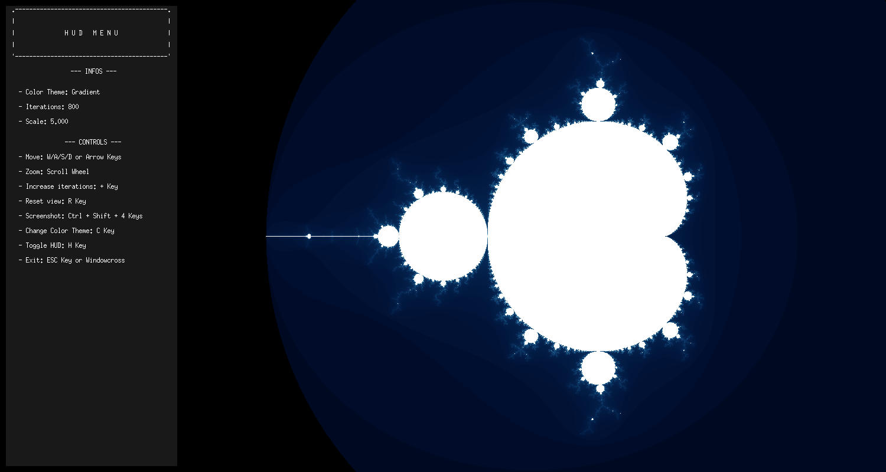

# fractol


**An interactive fractal explorer written from scratch in C.** Mandelbrot,
Julia and Sierpinski-carpet renders are computed pixel by pixel into a MiniLibX
window with cursor-anchored zoom, live Julia-constant selection and seven color
themes.

*Real-time rendering · complex numbers · event-driven UI · graphics math*



## Highlights

- **Three renderers, one binary** — escape-time Mandelbrot and Julia
  (double-precision complex iteration) plus an integer base-3 Sierpinski
  carpet.
- **Interactive Julia sets** — pick `c` from the command line or directly on
  the Mandelbrot plane (`SPACE`, then click); the set re-renders immediately.
- **Cursor-anchored zoom** — the point under the mouse stays fixed while
  scroll-zoom scales the view and raises the iteration budget (capped at 1000)
  to keep detail at every depth.
- **Seven color themes** — psychedelic, monochrome, gradient, smooth (log-log
  escape smoothing), fire, ocean and custom RGB. `C` cycles the themes
  available for the current fractal (some combinations are rejected at
  launch); custom RGB is set on the command line.
- **Live HUD** — current theme, iteration count, zoom scale and, for Julia
  sets, the active constants.

## Quick start

```console
$ make
$ ./fractol Mandelbrot Ocean 200
$ ./fractol Julia Smooth 500 0.285 0.01
$ ./fractol Sierpinski Psychedelic 5
$ ./fractol Mandelbrot "255 120 0" 300        # custom RGB theme
```

Usage: `./fractol <julia|mandelbrot|sierpinski> [theme] [iterations] [cr ci]`.
`./fractol --help` prints the full reference. Requirements: GCC or clang, GNU
make, X11 development headers (`libx11-dev`, `libxext-dev`) and a running X
server; MiniLibX is vendored in `mlx/`.

## Controls

| Input | Action |
| --- | --- |
| `WASD` / arrows | Pan the view |
| Scroll up / down | Zoom in / out |
| `SPACE` | Julia-constant picker (click on the Mandelbrot plane) |
| `C` | Cycle color theme |
| `SHIFT` | Shift colors (psychedelic theme) |
| `=` / `+` | Increase iteration count |
| `R` | Reset view |
| `H` | Toggle HUD |
| `Esc` | Quit |

## Under the hood

- `src/compute_fractals.c` — iteration kernels and viewport → complex mapping.
- `src/drawing.c` — color mapping (including log-log smooth coloring) and the
  renderer: every frame fills a raw pixel buffer, then a single
  `mlx_put_image_to_window`.
- `src/event_handlers.c` — keyboard and mouse events; `src/hud.c` — overlay.
- `src/init_data.c` — MLX/window setup, theme selection, HUD defaults.
- `src/init_fractal.c` — fractal type, iteration count and Julia-constant
  validation.

```console
$ make debug   # rebuild with -g3 -fsanitize=address,undefined
```

## Scope

CPU-only, single-threaded rendering: the fractal is recomputed on every
interaction; there is no automated test suite (rendering is checked manually
and with sanitizer builds). X11 is required (Linux, or WSL with an X server).

---

42 Paris curriculum project · solo · Yassmine Abdallah ([@imyassmine](https://github.com/imyassmine))
